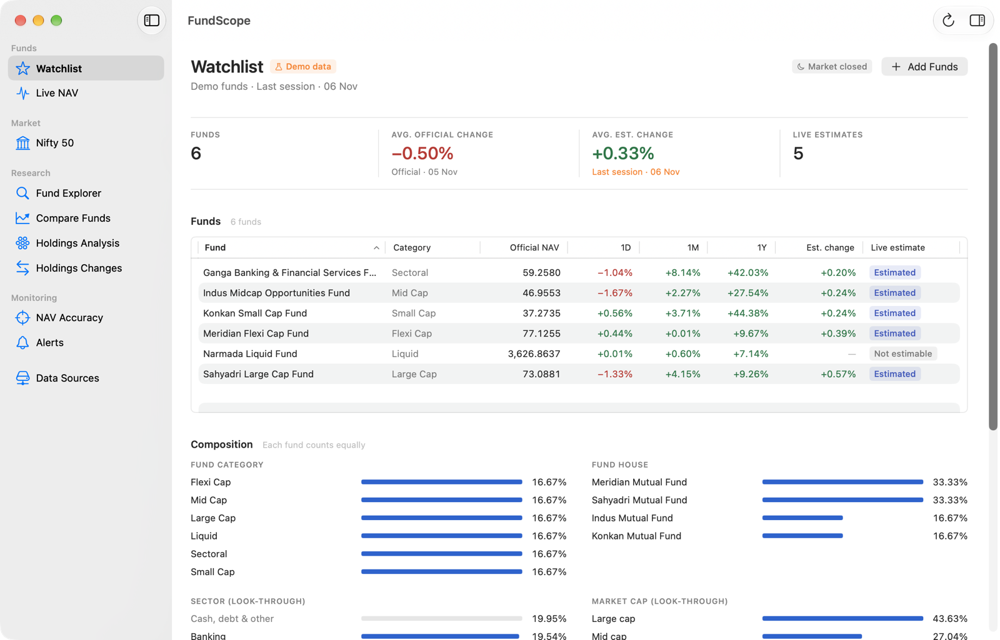
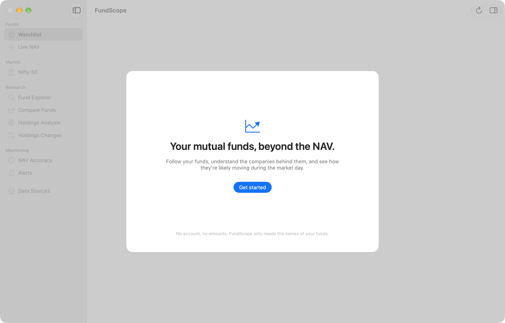
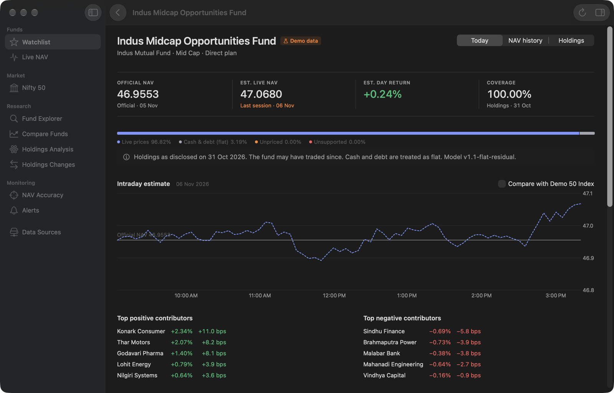
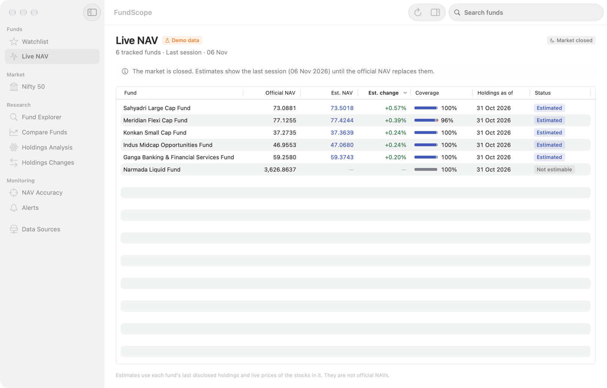
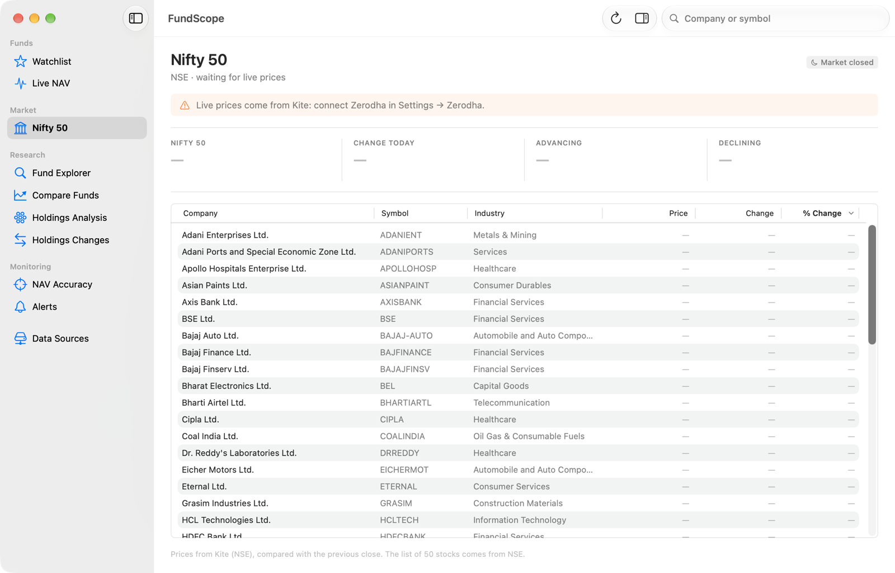
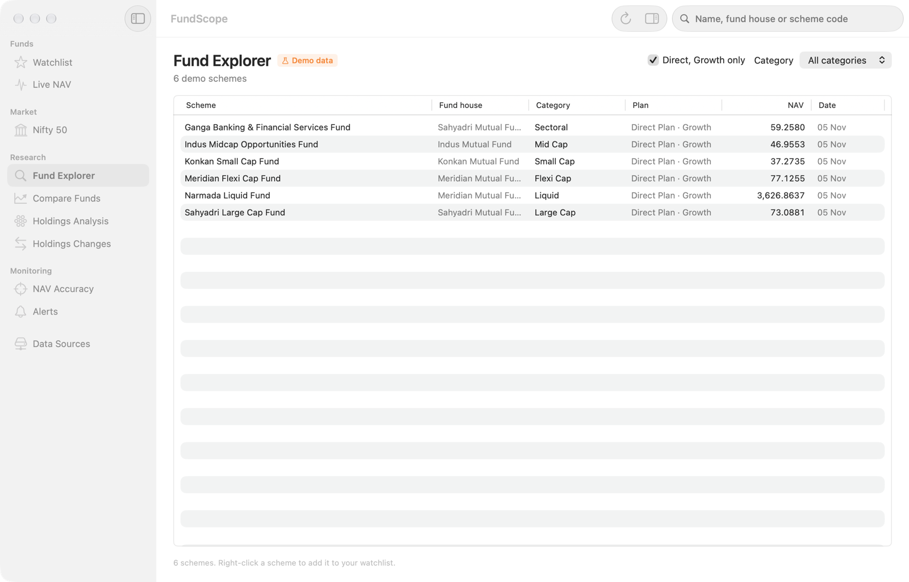
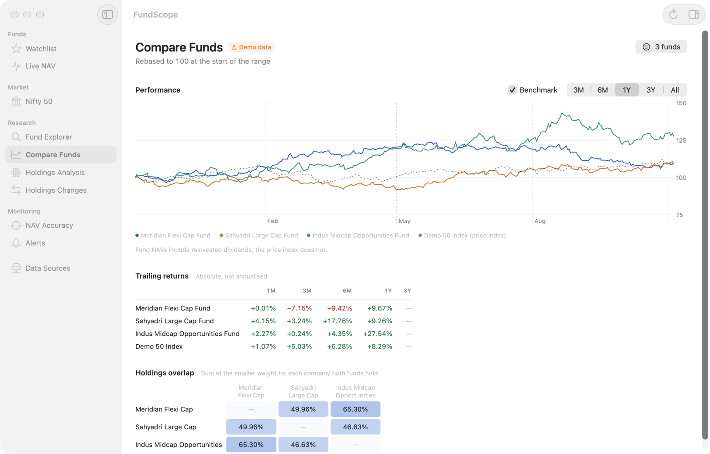
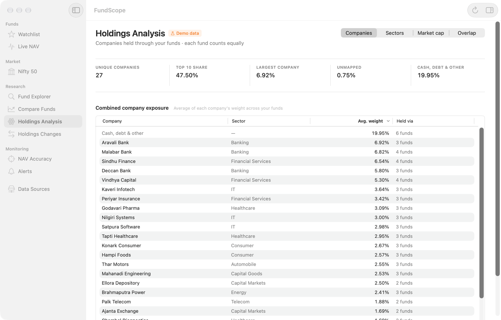
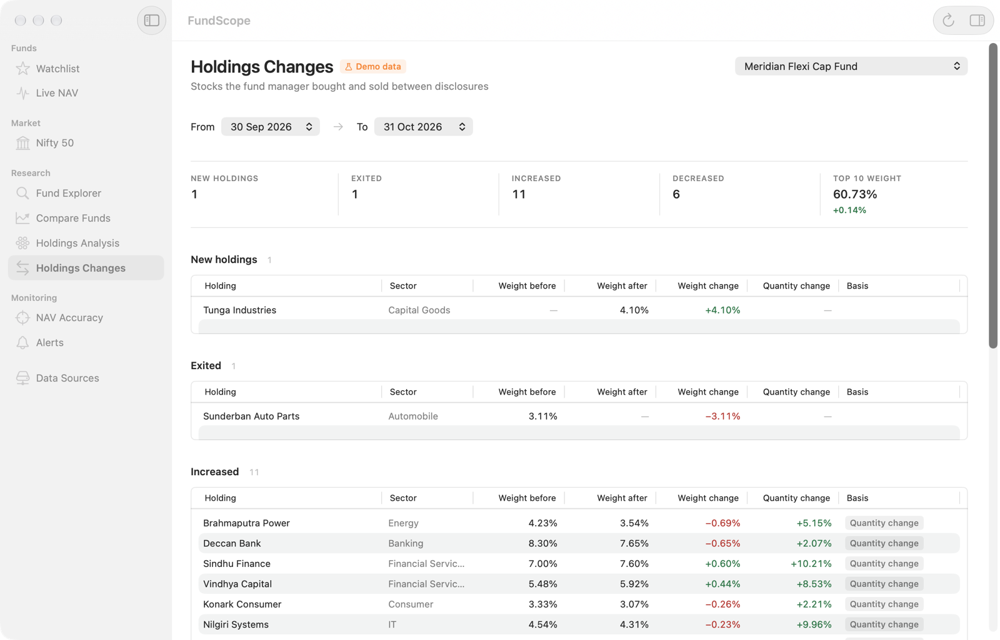

# FundScope

**Your Indian mutual funds, beyond the NAV.** FundScope is a native macOS app that follows your mutual funds, shows the companies inside them, and estimates how each fund is moving *during* the market day, hours before the official NAV is published.



- **Native and local.** SwiftUI, macOS 15+. No server, no account, no analytics. Everything stays on your Mac.
- **Names only, never money.** FundScope needs only the *names* of your funds. It never asks what you invested, and it can't place orders.
- **Live NAV estimates.** It combines each fund's latest disclosed holdings with live stock prices from your own Zerodha Kite Connect app.
- **Live Nifty 50.** The index and all 50 stocks update every 2 seconds while the page is open.

> FundScope is a personal tool, not investment advice. Estimates are estimates. The official NAV from AMFI is always the real number.

---

## Contents
1. [What FundScope does](#what-fundscope-does)
2. [Install](#install)
3. [Getting started](#getting-started)
   - [1. Add your funds](#1-add-your-funds)
   - [2. Import fund holdings](#2-import-fund-holdings)
   - [3. Connect Zerodha Kite for live prices](#3-connect-zerodha-kite-for-live-prices)
4. [A tour of the screens](#a-tour-of-the-screens)
5. [How the live estimate works](#how-the-live-estimate-works)
6. [Keyboard shortcuts](#keyboard-shortcuts)
7. [Privacy and security](#privacy-and-security)
8. [Where the data comes from](#where-the-data-comes-from)
9. [Build from source](#build-from-source)
10. [Sharing with family](#sharing-with-family)
11. [Project layout](#project-layout)
12. [Limitations](#limitations)
13. [License](#license)

---

## What FundScope does

| You want to… | FundScope shows you… |
|---|---|
| See all your funds at a glance | Official NAV, 1-day / 1-month / 1-year change and today's live estimate, in one table |
| Know how your funds are doing *right now* | An estimated NAV during market hours, built from each fund's holdings and live stock prices |
| Understand what you actually own | Look-through holdings: every company across your funds, sector mix and overlap between funds |
| Spot what a fund manager changed | Stocks added, removed, increased or cut between two monthly disclosures |
| Compare funds | NAV growth over 1M–5Y side by side |
| Follow the market | The Nifty 50 and its 50 stocks, live, green when up and red when down |
| Check how good the estimates are | Each day's estimate compared with the official NAV once AMFI publishes it |

There's also a **demo mode** with fictional funds, so you can explore every screen before adding your own.

---

## Install

### Option A: download a release
1. Download the latest `FundScope-<version>-macOS.zip` from the [Releases](https://github.com/wantedvikas/fundscope/releases/latest) page and unzip it.
2. Move **FundScope.app** to your **Applications** folder.
3. Double-click it. macOS says *"FundScope" Not Opened* because the app isn't notarised by Apple. That's expected for a free, self-signed app. Click **Done** (not "Move to Bin").
4. Open **System Settings → Privacy & Security**, scroll to **Security**, and click **Open Anyway** next to *"FundScope" was blocked*. Confirm with your password or Touch ID, then click **Open Anyway** again.

You only need to do this once per Mac, and again after each update. The **Open Anyway** button shows for about an hour after the blocked attempt. If it's missing, open the app again first.

### Option B: build it yourself
See [Build from source](#build-from-source).

---

## Getting started



On first launch FundScope offers two choices:
- **Add your funds** (recommended): build your watchlist.
- **Explore with demo data**: fictional funds and prices that show every screen, including live estimates. Leave demo mode any time from **Settings → General → Exit Demo**.

### 1. Add your funds

Open **Add Funds** with the **+ Add Funds** button on the Watchlist, or press **⇧⌘N**. There are three ways to add funds, and they can be combined:

| Mode | How to use it |
|---|---|
| **Search** | Type part of a fund name (for example "parag flexi"), pick **Direct** or **Regular**, and click **Add**. Short forms work: "ICICI Pru", "WOC", "PPFAS", "Smallcap". |
| **Paste a list** | Paste fund names, one per line, and click **Find Funds**. Check each match (change it or choose *Don't add*), then click **Add N Funds**. |
| **From a file** | Pick a holdings export (CSV or XLSX), for example Zerodha Coin's *Mutual Funds Holdings* export. **Only the fund name and plan columns are read.** Units, amounts and P&L are ignored and never stored. |

Every name is matched against AMFI's official scheme list. When a name could match more than one scheme, FundScope asks you to pick instead of guessing.

After you add funds, FundScope downloads today's official NAV from AMFI, then up to 5 years of NAV history in the background. The first time takes 2–3 minutes; you'll see "Downloading NAV history… n of N" under the Watchlist title.

### 2. Import fund holdings

Holdings are what make live estimates, look-through analysis and change tracking possible. Every fund house publishes each fund's full portfolio once a month.

**Download the monthly portfolio file:**
1. Go to your fund house's website (for example ppfas.com, hdfcfund.com, icicipruamc.com).
2. Find **Statutory Disclosures → Monthly Portfolio** (sometimes "Portfolio Disclosure" or "Downloads").
3. Download the latest month's file for your fund. It's usually an **.xlsx**. Some fund houses put all their funds in one workbook, one sheet each; that's fine.

**Import it:**
1. Press **⇧⌘I** (or **File → Import Fund Holdings…**, or **Import Holdings** on the Watchlist).
2. Drag the files into the window, or click to choose them. You can import several at once.
3. FundScope reads each sheet and shows a preview: fund title, "as on" date, number of holdings and total weight. It also shows warnings, for example when weights don't add up to 100%.
4. Each sheet is matched to a fund in your watchlist **only when the names agree word for word**. Otherwise choose the fund from the **Fund** menu, or leave it as *Not in watchlist* to skip it.
5. Click **Import N Portfolios**.

Notes:
- Holdings are saved once per fund per month and are never edited afterwards. Importing the same file again adds nothing.
- Old binary **.xls** files can't be read. Open them in Numbers or Excel and save as **.xlsx**. Some fund houses name modern files ".xls"; those work as they are.
- Repeat each month (portfolios are usually published by the 10th) to keep estimates accurate and to fill the **Holdings Changes** screen.

### 3. Connect Zerodha Kite for live prices

Live NAV estimates and the Nifty 50 page need live stock prices. FundScope gets them from **your own** Kite Connect app. It never sees your Zerodha password.

**Create your Kite Connect app (one time):**
1. Sign in at **[developers.kite.trade](https://developers.kite.trade)** and create an app on the **Kite Connect** plan. This is a paid plan (about ₹500/month at the time of writing); the free *Personal* plan doesn't include live quotes.
2. In FundScope, open **Settings (⌘,) → Zerodha** and click **Copy** next to **Redirect URL**. It is `http://127.0.0.1:7313/kite`.
3. Paste that into the app's **Redirect URL** field on developers.kite.trade and save.
4. Copy the app's **API key** and **API secret** into FundScope's **API key** and **API secret** fields, then click **Save to Keychain**.

**Sign in (once a day):**
1. Click **Connect** in Settings → Zerodha. Zerodha's own login page opens in your browser.
2. Sign in there as usual. You'll see *"Signed in. You can close this tab and return to FundScope."*
3. Status changes to **Connected**. Prices refresh every minute in market hours, and every 2 seconds on the Nifty page.

Zerodha ends Kite sessions every day, so you'll see **Requires authentication** the next morning. Click **Reconnect** and sign in again. If the browser shows an error page instead of the confirmation, paste that page's address into the field under the Connect button and click **Use**.

Your key, secret and daily token are stored only in your Mac's **Keychain** (this device only, available while unlocked). They're never written to files, logs or settings, and nothing is ever sent anywhere except Zerodha.

---

## A tour of the screens

### Watchlist


Your funds with **official NAV** (from AMFI), **1D / 1M / 1Y** change, today's **estimated change** and the estimate's status. Above the table: the average official change and average estimated change across your funds (each fund counts equally), and how many funds have a live estimate. Below it, **Composition** shows your funds by category. Click a fund to open its detail page; right-click for more options.

### Live NAV


For each fund: official NAV, **estimated NAV**, estimated change, a **coverage meter** (how much of the fund has live prices), the holdings date, and a status:
- **Estimated**: 90% or more of the fund is accounted for.
- **Low coverage**: 75–90%. Treat it with care.
- **Not estimable**: hover over the pill to see why. Usually more than 10% of the fund is in things that can't be priced live (foreign stocks, REITs/InvITs, other mutual funds), or no holdings have been imported yet.

After the market closes, the estimates show the last session until AMFI publishes the official NAV (usually late evening).

### Nifty 50


The Nifty 50 index level, its change in points and percent, how many stocks are advancing and declining, and a table of all 50 stocks with price, ₹ change and % change. It's sorted by % change and searchable by company or symbol. Stocks that are up are green with a **+**, stocks that are down are red with a **−**. While the page is open, prices update **every 2 seconds** in market hours (once a minute outside them) with no refresh needed. The stock list comes from NSE's official Nifty 50 file and is refreshed weekly.

### Fund detail
Click any fund to open it. There are three tabs:
- **Today**: intraday estimated NAV against the official baseline, plus the stocks pushing the fund up or down most.
- **NAV history**: official NAV over 1M, 3M, 6M, 1Y, 3Y, 5Y or all time.
- **Holdings**: the full disclosed portfolio (holding, sector, asset type, weight, quantity), sector mix and the list of months imported.

### Fund Explorer


Browse every scheme in AMFI's list, about 14,000 schemes. Filter by category, show only Direct Growth plans, and search by name, fund house or scheme code. Right-click a scheme to add it to your watchlist.

### Compare Funds


Pick funds and a period to compare their NAV growth on one chart.

### Holdings Analysis


A look-through of all your funds combined, each fund weighted equally: your largest underlying companies, sector exposure, and **overlap** between funds (how much of two funds is the same stocks). Cash, debt and other non-stock holdings are kept separate, and unmapped holdings are counted rather than hidden.

### Holdings Changes


What each fund manager did between two monthly disclosures: **new** stocks, **exits**, and positions **increased** or **reduced**. It needs at least two months of holdings for a fund.

### NAV Accuracy
Every day after market close, FundScope saves each fund's final estimate, which is never edited afterwards. Once AMFI publishes the official NAV, this screen shows the error for each day and fund, so you can see how far to trust the estimates.

### Data Sources
The health of each source: AMFI (last download), Kite (connected, needs sign-in, or error), and the holdings import (which funds still need a disclosure). When a source fails, FundScope keeps showing the last good data with its timestamp. It never shows made-up or zero values.

---

## How the live estimate works

```
estimated NAV = yesterday's official NAV × (1 + estimated return)

estimated return = Σ (weight of each priced holding × its price change today)
                 + unpriced Indian stocks × (average change of the priced stocks)
                 + cash, debt, hedged pairs, liquid-fund units × 0
```

- **Weights** come from the latest monthly disclosure you imported. **Price changes** are live Kite prices against the previous close.
- **Priced:** Indian stocks and ETFs (such as a gold ETF) listed on the NSE.
- **Flat (assumed unchanged today):** cash, TREPS, debt, arbitrage hedged pairs, and liquid/money-market/overnight fund units.
- **Can't be priced:** foreign stocks, REITs and InvITs, other mutual funds, and unhedged derivatives. If these exceed 10% of a fund, or coverage falls below 75%, the fund is **Not estimable**, and no number is shown rather than a guess.
- The baseline must be the official NAV for the trading day before today; otherwise FundScope waits.
- Only **equity and hybrid** funds are estimated. Debt, liquid, index-fund-of-funds and ETF schemes aren't.

The estimate drifts as the fund trades during the month after its disclosure date. The **NAV Accuracy** screen shows how much.

---

## Keyboard shortcuts

| Shortcut | Action |
|---|---|
| ⇧⌘N | Add Funds |
| ⇧⌘I | Import Fund Holdings |
| ⌘R | Refresh NAVs from AMFI |
| ⌘1 … ⌘9 | Jump to a sidebar section |
| ⌘F | Search the current screen |
| ⌘, | Settings |

---

## Privacy and security

- **No amounts, ever.** FundScope stores only which funds you follow (names and AMFI scheme codes), public NAVs and public portfolio disclosures.
- **No password.** You sign in to Zerodha on Zerodha's own page. FundScope gets a daily read-only token and can't place orders; there is no order code in the app.
- **Keychain only.** The Kite API key, secret and token live in the macOS Keychain with *this device only, when unlocked* access. They're never in files, settings, logs or this repository.
- **No server, no tracking.** The app talks only to AMFI, NSE's public archive and Kite (`api.kite.trade`, `kite.zerodha.com`), over HTTPS. App Sandbox and Hardened Runtime are on.
- **Local data** lives in `~/Library/Containers/com.vikasghodke.FundScope/Data/Library/Application Support/FundScope/`. Delete that folder to start fresh.

More detail is in [docs/11-security-privacy.md](docs/11-security-privacy.md).

---

## Where the data comes from

| Data | Source | How often |
|---|---|---|
| Official NAVs and the scheme list | AMFI `NAVAll.txt` | On launch, if older than 6 hours, and with ⌘R |
| NAV history (up to 5 years) | AMFI NAV history API | Once per fund, then daily |
| Fund portfolios | Each fund house's monthly disclosure, imported by you | Monthly |
| ISIN → NSE symbol | NSE `EQUITY_L.csv` and `eq_etfseclist.csv` | Weekly |
| Nifty 50 constituents | NSE `ind_nifty50list.csv` | Weekly |
| Live prices and the Nifty index | Your Kite Connect app, `/quote` | Every minute (fund estimates), every 2 s (Nifty page) |

Details and verification notes are in [docs/08-data-sources.md](docs/08-data-sources.md).

---

## Build from source

**Requirements:** macOS 15 or later, Xcode 26 or later (Swift 6). No paid Apple Developer account is needed; builds are signed ad hoc ("Sign to Run Locally").

```bash
git clone https://github.com/<you>/FundScope.git
cd FundScope
open FundScope.xcodeproj        # then press ⌘R in Xcode
```

Or from the command line:

```bash
xcodebuild -project FundScope.xcodeproj -scheme FundScope -configuration Debug build
swift test --package-path Packages/FundScopeCore
```

- The only third-party dependency is [ZIPFoundation](https://github.com/weichsel/ZIPFoundation), used to read XLSX files. Swift Package Manager fetches it automatically.
- **UI tests** (`xcodebuild … test -only-testing:FundScopeUITests`) take over the mouse and keyboard while they run, so start them when you're not using the Mac.
- Core tests never call live services. To run the opt-in live AMFI check: `FUNDSCOPE_LIVE=1 swift test --package-path Packages/FundScopeCore --filter LiveAMFI`.
- The app icon is drawn in code: edit and run `swift scripts/make-app-icon.swift`.

If you fork the project, change the bundle identifier (`com.vikasghodke.FundScope`) in the Xcode project to your own.

---

## Sharing with family

`scripts/make-family-build.sh` makes a Release build (Intel + Apple Silicon) at `build/Family/FundScope.zip`. It **bundles your current watchlist and imported holdings**, so a family member's Mac opens straight to the same funds. It contains no amounts and no Kite credentials. Each person approves the app once with **Open Anyway** and connects their own Kite app for live prices.

---

## Project layout

```
FundScope/                    macOS app (SwiftUI)
  App/                        app entry, AppModel, sidebar and routing
  DesignSystem/               tokens, ValueText, MetricTile, tables, states
  Features/<Section>/         one folder per sidebar section
Packages/FundScopeCore/       pure Swift package: engine, parsers, providers, storage
  Sources/FundScopeCore/
    Engine/                   NAVEstimator, look-through, diffs, reconciliation
    Import/                   CSV/XLSX readers, disclosure parser
    Providers/                AMFI, Kite, NSE symbol lists, login callback
    Store/                    SwiftData watchlist, disclosure and estimate files, Keychain
  Tests/                      Swift Testing suites and anonymised fixtures
FundScopeUITests/             XCUITest smoke and flow tests
docs/                         product, design, architecture, data and testing specs
scripts/                      family build, app icon
AGENTS.md                     engineering rules for contributors (human or AI)
ROADMAP.md                    phases and their status
```

Contributors: please read [AGENTS.md](AGENTS.md) first. It covers the rules that keep FundScope honest (no fabricated data, `Decimal` for money, Keychain-only secrets, tests with every parser or engine change).

---

## Limitations

- **Estimates, not NAVs.** Holdings are a month old, intraday trades by the fund aren't visible, and foreign stocks, REITs and InvITs aren't priced.
- **Kite Connect is paid**, and each person needs their own app and a daily sign-in.
- **Disclosure layouts vary** by fund house. The parser handles PPFAS, HDFC, ICICI Prudential, Invesco, Nippon, Bandhan, WhiteOak and Abakkus files; others may need small fixes. Please open an issue with a sample file.
- **Not notarised**, so macOS asks for Open Anyway after each install.
- **Alerts** and a menu-bar view are planned but not built yet.

---

## License

[MIT](LICENSE). FundScope is not affiliated with Zerodha, AMFI, NSE or any fund house. Nothing in this app is investment advice.
